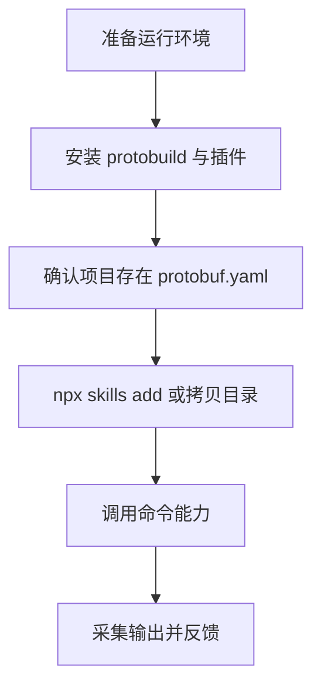
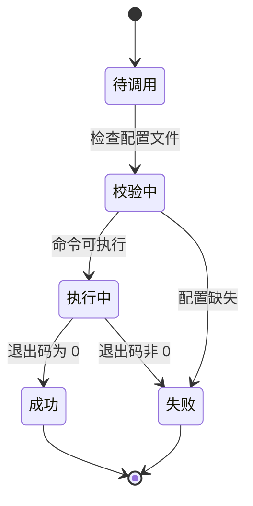

# 智能体技能接入指南

## 文档定位

本文件说明如何把 `protobuild` 作为 Agent Skill 接入智能体。

- **技能唯一真源**：仓库内 [`skills/protobuild/`](../skills/protobuild/) 目录（SKILL.md + references/）。本指南不再手抄命令清单——命令与 flag 一律以 [`references/commands.md`](../skills/protobuild/references/commands.md) 为准（守卫测试 `TestCommandsDocumentedInSkillRefs` 防漂移）。
- 上游文档：[`AUDIT_REVIEW.md`](./AUDIT_REVIEW.md)
- 总览入口：[`INDEX.md`](./INDEX.md)

## 接入方式

两条路径任选：

1. **npx skills（推荐）**——在目标项目根执行：

   ```bash
   npx skills add pubgo/protobuild          # 装到项目智能体技能目录
   npx skills add pubgo/protobuild -g       # 装到全局
   ```

   注意：`npx skills add` 解析仓库默认分支，合并后生效；开发期验证结构可用 `npx skills-ref validate skills/protobuild`。

2. **直接拷贝**——把 `skills/protobuild/` 整个目录拷入项目的 `.agents/skills/protobuild/`（或对应 harness 的技能目录）。

## 接入流程图



## 技能执行状态图



## 迁移提示

旧 `protobuild skills` 子命令已移除（内联模板不完整且与仓库漂移）。若此前用它生成过 `.agents/skills/protobuild/`：旧文件会与新装技能同名，可能遮蔽新内容——请删除旧目录后用上述任一方式重新安装。

## 推荐调用策略

1. 生成前先执行 `vendor`。
2. 写回型命令（`gen`、`format -w`、`install`、`buf`、`clean`）需提示用户文件会变化。
3. 持续集成场景优先用 `format --exit-code`、`lint` 与 `verify`。
4. 命令失败时返回标准错误输出摘要与修复建议（对照 [`references/troubleshooting.md`](../skills/protobuild/references/troubleshooting.md)）。

## 最小操作清单

```bash
protobuild vendor
protobuild gen
protobuild lint
protobuild format --exit-code
```

完整能力（init、breaking、doctor、update 等）见 [`skills/protobuild/SKILL.md`](../skills/protobuild/SKILL.md)。

## 关联阅读

- 技能真源：[`skills/protobuild/SKILL.md`](../skills/protobuild/SKILL.md)
- 项目入口：[`README.md`](../README.md)
- 架构设计：[`DESIGN.md`](./DESIGN.md)
- 配置示例：[`EXAMPLES.md`](./EXAMPLES.md)
